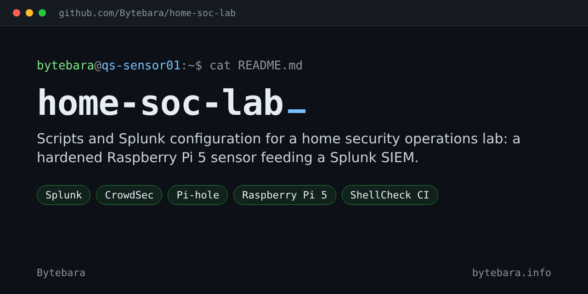
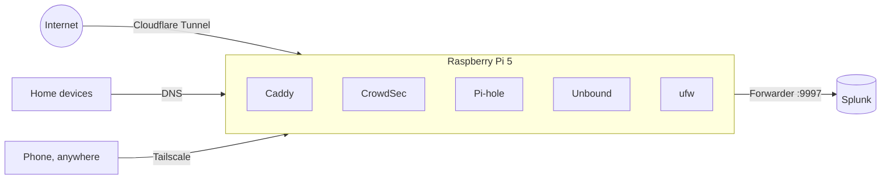

[](https://github.com/Bytebara/home-soc-lab/actions/workflows/tests.yml)
[](LICENSE)

I wanted to see how a security operations center works from the inside, so I built a small one at home. A Raspberry Pi 5 is the sensor: hardened, publicly reachable through a tunnel, and filtering DNS for my devices. Everything it sees goes to Splunk on an Ubuntu PC, where I search, build dashboards and hunt.

This repository is everything that sets it up: shell scripts for the Pi, a Splunk app for the server, and the tests that check both.



## What's in it

| Script | What it sets up |
|---|---|
| [`01-harden.sh`](pi/01-harden.sh) | Updates, key-only SSH, classic log files, a firewall that only lets in my home network |
| [`02-crowdsec.sh`](pi/02-crowdsec.sh) | CrowdSec and its firewall bouncer, tested with a fake attack before it's trusted |
| [`03-splunk-forwarder.sh`](pi/03-splunk-forwarder.sh) | The Splunk forwarder, running as a non-root user with read-only access to just the logs it needs |
| [`04-web-tunnel.sh`](pi/04-web-tunnel.sh) | My portfolio site on Caddy, published through Cloudflare Tunnel with no open router ports |
| [`05-pihole.sh`](pi/05-pihole.sh) | Pi-hole DNS filtering, with every lookup sent to Splunk |
| [`06-encrypt-dns.sh`](pi/06-encrypt-dns.sh) | Unbound, so Pi-hole's lookups leave the house encrypted (DNS over TLS) |
| [`07-tailscale.sh`](pi/07-tailscale.sh) | Remote access from my phone without exposing anything to the internet |
| [`08-pihole-tailscale.sh`](pi/08-pihole-tailscale.sh) | Ad and tracker blocking on my phone, anywhere |
| [`splunk/`](splunk/) | The Splunk app: index, field extractions, [saved searches](splunk/searches.md) and a dashboard |

## How the scripts behave

- **Check first.** Every script runs in check mode by default and prints exactly what it would change. Nothing happens until `--apply`.
- **Fail safe.** Risky steps test themselves and roll back: the DNS scripts switch back to the old setting if lookups stop working, and SSH changes are validated before reload.
- **Least privilege.** The forwarder isn't root; services listen on localhost unless they need the network; firewall rules name the network they allow.
- **Tested.** CI runs ShellCheck on every script and checks every Splunk field extraction against sample log lines.

## Things that broke, and what they taught me

- **Two programs, one port.** Caddy wouldn't start because CrowdSec's local API already owned port 8080. Now every script checks its port with `ss` before installing anything, and Pi-hole's dashboard is pinned to 8082 before its installer can grab 80 or fall back to 8080.
- **A pipe that lied.** A re-run stopped with a false "not found": under `set -o pipefail`, `cmd | grep -q` exits early, `cmd` gets SIGPIPE, and the pipeline reports failure even though the match was there. The tests now forbid that pattern.
- **Every firewall event, twice.** Blocks showed up in both `ufw.log` and `syslog`. One rsyslog `& stop` line fixed it; I confirmed it in Splunk by counting duplicates before and after.
- **The field that wasn't there.** Pi-hole's "blocked" log line doesn't say which device asked. The per-device report carries the client over from the matching query line with `streamstats`.
- **The VPN that hid everything.** My first DNS test looked blocked, but by my VPN's filter, not Pi-hole. Lesson: check *which* server answered before trusting a result.
- **Logs the forwarder couldn't read.** CrowdSec writes root-only logs. A file ACL plus a systemd timer (not cron, which isn't guaranteed on Pi OS) keeps them readable after rotation.

## Getting started

The full walkthrough, from flashing the SD card to the last script, is in [docs/SETUP.md](docs/SETUP.md). Short version, on the Pi:

```bash
git clone https://github.com/Bytebara/home-soc-lab.git
cd home-soc-lab/pi
./01-harden.sh              # read the plan
sudo ./01-harden.sh --apply # make the changes
```

Then work through the scripts in order. Addresses in examples are private home-network or documentation ranges.

---

Part of my portfolio at [bytebara.info](https://bytebara.info). Run and debugged on my own hardware. [MIT licensed](LICENSE).
