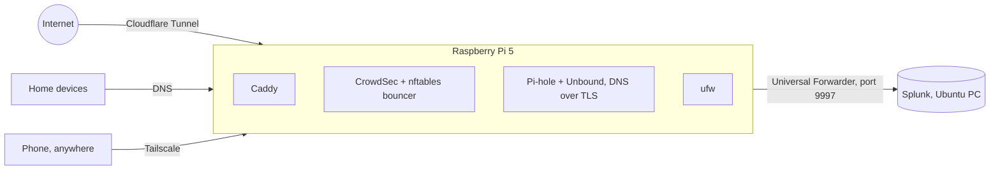

# Home SOC lab

[](https://github.com/Bytebara/home-soc-lab/actions/workflows/tests.yml)

The scripts and Splunk configuration behind my home security operations lab: a Raspberry Pi 5 as a hardened sensor and public web server, and Splunk on an Ubuntu PC as the SIEM. Every script previews its changes first (`--check`, the default) and only changes the system with `--apply`.



**What's covered:** SSH hardening and firewall, CrowdSec, the Splunk forwarder with least-privilege log access, a website behind Cloudflare Tunnel with security headers, Pi-hole with DNS logs in Splunk, encrypted upstream DNS, and Tailscale remote access. The Splunk app has field extractions, saved searches and a dashboard; the tests check every extraction against sample log lines and the scripts with ShellCheck.

Addresses in the examples are private home-network or documentation ranges. Developed with AI assistance; reviewed and run on my own hardware. Portfolio: [bytebara.info](https://bytebara.info).

---

## Using the kit

Scripts and Splunk configuration for the home SOC lab:

- **Raspberry Pi 5** as the sensor: hardened, protected by CrowdSec, sending logs to Splunk.
- **Ubuntu PC** as the analysis server: Splunk with a ready-made index, searches and dashboard.

```
quiet-signal-lab-kit/
  pi/
    01-harden.sh             Phase 3: updates, log files, keys-only SSH, firewall
    02-crowdsec.sh           Phase 3: CrowdSec + firewall bouncer, with built-in tests
    03-splunk-forwarder.sh   Phase 4: Splunk Universal Forwarder on the Pi
    04-web-tunnel.sh         Phase 5: website on the Pi (Caddy) + Cloudflare Tunnel
    05-pihole.sh             Project A: Pi-hole DNS filtering + DNS logs to Splunk
    06-encrypt-dns.sh        Project A: Pi-hole's lookups to Quad9 encrypted (Unbound, DNS over TLS)
    07-tailscale.sh          Reach the lab from anywhere (Tailscale); run on the Pi AND the Ubuntu PC
    08-pihole-tailscale.sh   Pi-hole for your Tailscale devices (ad blocking on the phone anywhere)
    Caddyfile.template       Caddy settings used by 04 (security headers, local only)
    common.sh                shared helpers (not run directly)
  splunk/
    install-server.sh        Phase 4: Splunk + the lab app on the Ubuntu PC
    server-app/              the "Quiet Signal Lab" Splunk app
    forwarder-app/           what the Pi sends to Splunk (qs_pilab_dns = Pi-hole log)
    searches.md              every search explained
  tests/                     the checks run on this kit before you got it
```

## How the scripts work

Every script has two modes:

- **Check (default):** `./01-harden.sh` prints exactly what it would do and changes nothing. Run this first, every time.
- **Apply:** `sudo ./01-harden.sh --apply` makes the changes.

They stop with a clear message instead of guessing when something is wrong, and they back up any file they replace (`<file>.qs-backup`).

Read a script before you run it. Each one explains every step in plain comments. Running scripts from the internet without reading them is exactly what you'd warn others against.

## Order of use

### Phase 2: first boot (no scripts yet)

1. In Raspberry Pi Imager choose **Raspberry Pi 5**, **Raspberry Pi OS Lite (64-bit)**, and your card.
2. Edit settings: hostname (`qs-sensor01`), username (not `pi`, not your name), password, Wi-Fi if not using Ethernet, time zone. On the Services tab: enable SSH, **allow public-key authentication only**, and paste your public key.
3. Write the card, put it in the Pi, connect Ethernet, then power.
4. From your computer: `ssh <username>@qs-sensor01.local`

### Phase 3: harden and protect the Pi

Copy the kit to the Pi from your computer:

```
scp quiet-signal-lab-kit.zip <username>@qs-sensor01.local:~
```

On the Pi:

```
sudo apt-get install -y unzip
unzip quiet-signal-lab-kit.zip && cd quiet-signal-lab-kit/pi
chmod +x *.sh

./01-harden.sh                 # read the plan
sudo ./01-harden.sh --apply    # do it
```

**Keep that SSH window open.** Open a second terminal and log in again. If it works, close the old window. If not, the script prints the two undo commands to run in the window that's still connected.

Then:

```
./02-crowdsec.sh
sudo ./02-crowdsec.sh --apply
```

It asks before running CrowdSec's official repository script, then tests detection with a fake log line and tests blocking with a documentation-only address (203.0.113.99), which it removes afterward.

### Phase 4: Splunk

**On the Ubuntu PC:**

1. Give it a fixed IP on your router.
2. Download **Splunk Enterprise for Linux (.deb)** from splunk.com (free account, use your alias email).
3. Run:

   ```
   cd quiet-signal-lab-kit/splunk && chmod +x install-server.sh
   ./install-server.sh ~/Downloads/splunk-*.deb <pi-ip>
   sudo ./install-server.sh ~/Downloads/splunk-*.deb <pi-ip> --apply
   ```

4. Open http://localhost:8000, log in, open the **Quiet Signal Lab** app.

**Pi not set up yet?** Use `later` in place of `<pi-ip>`. Everything installs, and the script prints the one firewall command to run once the Pi has its address.

**On the Pi:**

1. On splunk.com download the **Universal Forwarder** for **Linux → ARMv8 (64-bit)**, and copy it to the Pi with `scp`.
2. Run:

   ```
   ./03-splunk-forwarder.sh ~/splunkforwarder-*.deb <ubuntu-pc-ip>
   sudo ./03-splunk-forwarder.sh ~/splunkforwarder-*.deb <ubuntu-pc-ip> --apply
   ```

3. In Splunk search: `index=pilab | stats count by sourcetype`

**If the forwarder won't start on the Pi 5:** the Pi 5 uses 16 KB memory pages by default, which some ARM programs don't support. The script warns about this. Add `kernel=kernel8.img` to the end of `/boot/firmware/config.txt`, reboot and run it again.


### Phase 5: publish the website from the Pi

1. **Domain:** buy one in Cloudflare (Domain Registration). Pick a TLD that allows WHOIS privacy (.com, .net, .dev, .org); avoid .us, which forbids it.
2. **Tunnel:** Cloudflare dashboard > Networking > Tunnels > Create a tunnel > name it `qs-sensor01`. Choose Debian / arm64 and copy the **token** from the install command it shows. Don't run that command; the script does it. Keep the token secret.
3. **Build the site for your domain** (Windows PowerShell, in the website folder):

   ```
   $env:SITE_URL="https://yourdomain"; $env:SITE_BASE="/"; npm run build
   scp -r dist bytebara@192.168.1.15:~/site
   Remove-Item Env:SITE_URL, Env:SITE_BASE
   ```

4. **On the Pi:**

   ```
   cd ~/quiet-signal-lab-kit/pi
   ./04-web-tunnel.sh ~/site yourdomain
   sudo ./04-web-tunnel.sh ~/site yourdomain --apply
   ```

5. **Route:** in the tunnel's Routes tab: Add route > Published application > Subdomain empty, Domain = yours, Service URL `http://127.0.0.1:8081`.
6. Visit `https://yourdomain`. In Splunk: `index=pilab sourcetype=caddy:access`.

To update the site later: rebuild, copy to `~/site` again, and re-run step 4 (it replaces the old files).

### Project A: Pi-hole (DNS filtering)

Pi-hole answers DNS lookups ("what's the address of example.com?") for devices that use it, and refuses to answer for ad, tracker and known-bad domains. Every lookup goes to Splunk.

1. **On the Ubuntu PC**, update the Splunk app first (new DNS reports and dashboard panels):

   ```
   cd ~/quiet-signal-lab-kit/splunk
   sudo ./install-server.sh ~/Downloads/splunk-*.deb 192.168.1.15 --apply
   ```

2. **On the Pi:**

   ```
   cd ~/quiet-signal-lab-kit/pi
   ./05-pihole.sh
   sudo ./05-pihole.sh --apply
   ```

   It asks twice: before running Pi-hole's installer, and to set the dashboard password.

3. **Point ONE computer at it** (its DNS server = the Pi's address). Leave every other device alone until it has run smoothly for a week. To undo on that computer, set DNS back to automatic.
4. Dashboard: `http://192.168.1.15:8082/admin`. Splunk: `index=pilab sourcetype=pihole`.

Ports on the Pi after this: 22 SSH (home network), 53 DNS (home network), 8082 Pi-hole dashboard (home network), 8080 CrowdSec and 8081 Caddy (Pi only).

**If the Pi is off,** computers pointed at it can't look up names (websites won't load). Switch that computer's DNS back to automatic. This is why it starts with one computer.

**Encrypt Pi-hole's lookups (optional, recommended):**

```
./06-encrypt-dns.sh
sudo ./06-encrypt-dns.sh --apply
```

Unbound runs on the Pi (127.0.0.1:5335, never on the network) and sends Pi-hole's lookups to Quad9 over TLS on port 853, checking Quad9's certificate. Your provider then sees only that you use Quad9, not which names you look up. The script tests Unbound alone before switching Pi-hole, and switches back to plain Quad9 if anything fails. Check from Windows: `nslookup -type=txt proto.on.quad9.net` answers `dot`.

### Remote access: Tailscale

Free Personal plan. Each machine joins your private Tailscale network by connecting outward, so nothing is opened on the router.

1. Create a Tailscale account (sign in with your alias GitHub account, which has two-factor sign-in on).
2. Install the Tailscale app on Windows and your phone and sign in.
3. On the Pi, then on the Ubuntu PC:

   ```
   ./07-tailscale.sh
   sudo ./07-tailscale.sh --apply
   ```

   Open the link it prints and approve the machine.

Only each machine itself is shared: no subnet routing, no exit node, and `--accept-dns=false` so Pi-hole keeps handling DNS. SSH is allowed in from the `tailscale0` interface. Splunk's web page stays closed; from anywhere, use `ssh -L 8000:localhost:8000 bytebara@<ubuntu-tailscale-address>`.

**Pi-hole on your phone, anywhere:** on the Pi run `./08-pihole-tailscale.sh`, then `sudo ./08-pihole-tailscale.sh --apply`. It opens DNS to Tailscale devices only and switches Pi-hole to answer them (only after checking the firewall blocks incoming traffic by default). Then in login.tailscale.com > DNS add the Pi's Tailscale address as a custom nameserver and turn on "Override DNS servers". If the Pi is off, switch Tailscale off on the phone.

## What's in the Splunk app

- **Index** `pilab`, capped at 5 GB and 90 days
- **Receiver** on port 9997, opened only to the Pi's address
- **Field extractions** for SSH, sudo, ufw, CrowdSec, Caddy (Phase 5) and Pi-hole DNS logs
- **Reports:** failed SSH logins, successful logins, sudo commands, CrowdSec bans, firewall blocks, web visitors, web scanning, DNS lookups by device, top domains, blocked domains, odd-looking domains
- **Alert:** Pi stopped sending logs (off by default; alerts need the Enterprise trial)
- **Dashboard:** Pi lab overview

See `splunk/searches.md` for what each search does.

## Undo

| To undo | Run on the Pi |
|---|---|
| SSH changes | `sudo rm /etc/ssh/sshd_config.d/10-quiet-signal.conf && sudo systemctl reload ssh` |
| Firewall | `sudo ufw disable` |
| CrowdSec | `sudo apt-get remove crowdsec crowdsec-firewall-bouncer-nftables` |
| Forwarder | `sudo systemctl stop SplunkForwarder && sudo dpkg -r splunkforwarder` |
| Website and tunnel | `sudo cloudflared service uninstall && sudo apt-get remove caddy cloudflared` |
| Pi-hole | `sudo pihole uninstall`, then `sudo rm -r /opt/splunkforwarder/etc/apps/qs_pilab_dns && sudo systemctl restart SplunkForwarder`, then `sudo ufw status numbered` and `sudo ufw delete <number>` for the three Pi-hole rules |
| DNS encryption | `sudo pihole-FTL --config dns.upstreams '["9.9.9.9","149.112.112.112"]'`, then `sudo apt-get remove unbound && sudo rm /etc/unbound/unbound.conf.d/qs-quad9-dot.conf` |
| Tailscale | `sudo tailscale logout && sudo apt-get remove tailscale`, then remove the machine in the Tailscale admin page and delete the `SSH from Tailscale devices` ufw rule |
| Log access for the forwarder | `sudo systemctl disable --now qs-crowdsec-log-acl.timer && sudo rm /etc/systemd/system/qs-crowdsec-log-acl.*` |

## Notes for your write-up

- **Why the Pi's SSH only accepts your home network:** the public reaches the Pi only through Cloudflare Tunnel (Phase 5), which is an outbound connection, so no inbound port needs to be open at all.
- **Why Pi-hole uses Quad9 upstream:** Quad9 also refuses known malware and phishing domains, so there are two layers: Pi-hole's blocklists on the Pi, then Quad9's threat feed.
- **Why Pi-hole's dashboard is on 8082:** Pi-hole's built-in web server takes 80/443, or falls back to 8080, which is CrowdSec's. The script sets the port before installing so nothing collides.
- **Why the forwarder isn't root:** it runs as `splunkfwd` in the `adm` group, which can read logs but not change the system. That's least privilege.
- **Why CrowdSec ignores your home network:** its default whitelist skips private addresses, so you can't ban yourself.
- **What CrowdSec can and can't see after Phase 5:** every web request reaches Caddy from the tunnel, so it arrives from 127.0.0.1, which CrowdSec ignores as local. CrowdSec therefore doesn't detect or block web attacks yet; it still protects SSH. Splunk *does* see web attackers, because the app reads each visitor's real address from the `Cf-Connecting-Ip` header Cloudflare adds. Teaching CrowdSec to use that header (and blocking at Cloudflare instead of the Pi's firewall) is a planned next step.
